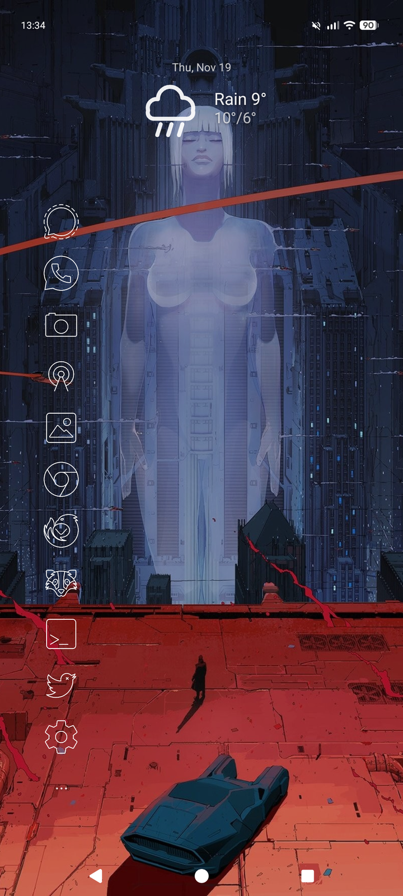
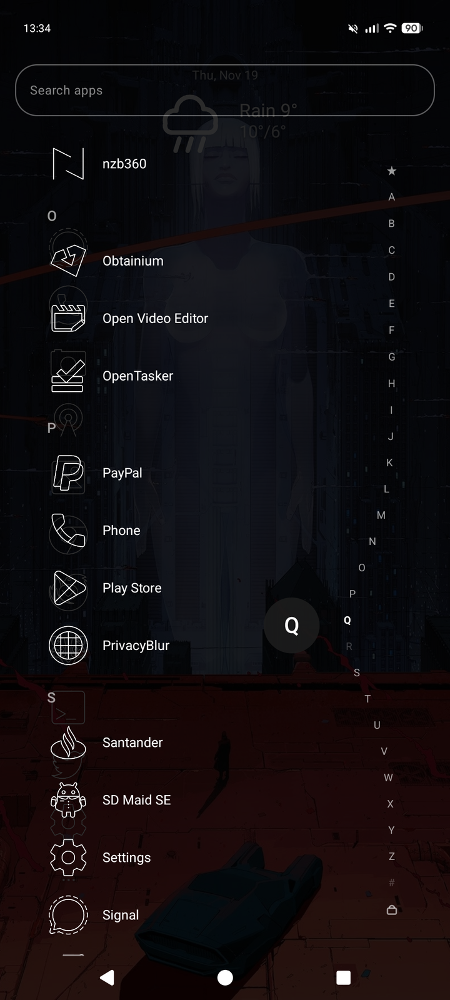
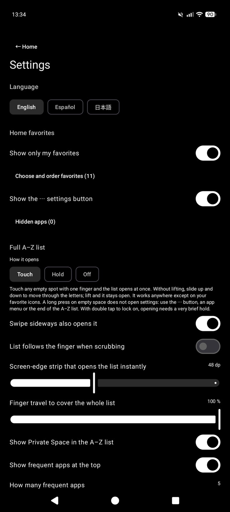

<p align="center">
  
</p>

# hashira 柱

[English](README.md) · [Español](README.es.md) · **日本語**

GrapheneOS 向けに作られた、ミニマルな Android ランチャーです。Kotlin と Jetpack Compose で作られており、解析ツールも Google サービスも使いません。バージョン 0.0.4。

## スクリーンショット

<p align="center">
  
  
  
</p>

スクリーンショットのアイコンは [Arcticons](https://github.com/Arcticons-Team/Arcticons)（CC BY-SA 4.0）のものです。hashira にアイコンパックは含まれていません。

## 機能

- お気に入りアプリの縦列を並べたホーム画面、検索付きの A–Z 全アプリ一覧、よく使うアプリ
- アイコンパック（ADW、Nova、Apex の `appfilter.xml`）、指紋または PIN で保護できる非表示アプリ
- プライベートスペースと仕事用プロファイルに対応
- 任意で使える天気予報（Open-Meteo）、通知ドット、ダブルタップによる画面ロック
- 英語、スペイン語、日本語の UI

Android 13 以降が必要です（minSdk 33）。

## 必要なもの

- Linux x86_64（以下の例は Arch Linux 向けです）
- JDK 17 以降
- Android SDK（プラットフォーム 37 と build-tools 36.0.0）
- git

## 環境構築（Arch Linux）

```sh
sudo pacman -S --needed jdk17-openjdk git unzip android-tools
```

複数の JDK がインストールされている場合は、`archlinux-java status` で確認し、`sudo archlinux-java set <名前>` で 17 以降のものを選んでください。

Android SDK のコマンドラインツールをインストールします。<https://developer.android.com/studio#command-tools> から Linux 用の「Command line tools only」zip をダウンロードし、次を実行します。

```sh
mkdir -p ~/Android/Sdk/cmdline-tools
unzip commandlinetools-linux-*_latest.zip -d ~/Android/Sdk/cmdline-tools
mv ~/Android/Sdk/cmdline-tools/cmdline-tools ~/Android/Sdk/cmdline-tools/latest

export ANDROID_HOME="$HOME/Android/Sdk"
export PATH="$PATH:$ANDROID_HOME/cmdline-tools/latest/bin:$ANDROID_HOME/platform-tools"

sdkmanager --licenses
sdkmanager "platform-tools" "platforms;android-37.0" "build-tools;36.0.0"
```

2 行の `export` はシェルの設定ファイル（`~/.bashrc` または `~/.zshrc`）に追加すると保持できます。ライセンスに同意済みであれば、不足している SDK コンポーネントは Gradle が自動でダウンロードします。

## ビルド

```sh
git clone https://github.com/hashira-launcher/hashira.git
cd hashira
./gradlew assembleDebug
```

APK は `app/build/outputs/apk/debug/app-debug.apk` に出力されます。デバッグビルドはリリースビルドよりかなり遅いため、普段使いにはリリースビルドを使ってください。

## リリースビルド

リリースビルドは自分の鍵で署名します。鍵はリポジトリに保存されません。

### 1. キーストアを作成する（初回のみ）

キーストアはリポジトリの外に置き、バックアップを取ってください。紛失すると、既存バージョンに上書きインストールできるアップデートを公開できなくなります。

```sh
mkdir -p ~/.keystores
keytool -genkeypair -v -keystore ~/.keystores/hashira-release.jks \
  -alias hashira -keyalg RSA -keysize 4096 -validity 10000
```

### 2. ビルドにキーストアの場所を伝える

方法 A：`keystore.properties` ファイルを使います（`.gitignore` に含まれています）。

```sh
cp keystore.properties.example keystore.properties
chmod 600 keystore.properties
# 編集：storeFile は絶対パス、パスワードとエイリアスを入力
```

デフォルトの PKCS12 キーストアでは、`keyPassword` を `storePassword` と同じにする必要があります。

方法 B：環境変数を使います（ファイルより優先されます）。

```sh
export HASHIRA_KEYSTORE_FILE=/home/you/.keystores/hashira-release.jks
export HASHIRA_KEYSTORE_PASSWORD=...
export HASHIRA_KEY_ALIAS=hashira
export HASHIRA_KEY_PASSWORD=...
```

### 3. リリーススクリプトを実行する

```sh
./release.sh
```

設定を確認し、署名済み APK をビルドして署名を検証し、チェックサムを作成して、ローカルの git タグを作ります。バージョンは `gradle.properties` の `hashira.versionName` から取得されます。

```
dist/hashira-0.0.4.apk
dist/hashira-0.0.4.apk.sha256
```

git タグを作らない場合は `./release.sh --no-tag` を使います。タグは `git push origin v0.0.4` で送信し、2 つのファイルを GitHub のリリースに添付してください。

署名設定がなくても `./gradlew assembleRelease` は動作しますが、未署名の APK が作られ、Android にはインストールできません。

### ダウンロードしたリリースを検証する

```sh
sha256sum -c hashira-0.0.4.apk.sha256
apksigner verify --print-certs hashira-0.0.4.apk
```

証明書のフィンガープリントを、メンテナーが公開しているものと比較してください。

## インストール

```sh
adb install -r dist/hashira-0.0.4.apk
```

または、APK を端末にコピーしてファイルマネージャーから開きます。その後、設定 → アプリ → デフォルトのアプリ → ホームアプリ で hashira を選択します。

アップデートは、インストール済みのバージョンと同じ鍵で署名する必要があります。

## プライバシーと権限

| 権限 | 用途 |
| --- | --- |
| `INTERNET` | Open-Meteo からの天気予報取得（有効にした場合のみ）。Android の設定で取り消してもランチャーは動作します。 |
| `ACCESS_COARSE_LOCATION` | 天気のための大まかな位置情報。「端末の位置情報」を選んだ場合のみ要求されます。 |
| `ACCESS_HIDDEN_PROFILES` | プライベートスペースの表示（Android 15 以降）。hashira が既定のランチャーのときのみ使用されます。 |
| `USE_BIOMETRIC` | 非表示アプリ一覧を開くための指紋または PIN。 |

任意の 2 つのコンポーネントには、Android の設定で追加の許可が必要です。画面ロックだけができるデバイス管理者（ダブルタップでロック。有効な間は Android がアンインストールを妨げます）と、通知ドット用の通知アクセス（パッケージ名のみで、内容は読み取りません）です。

## プロジェクト構成

```
app/src/main/java/com/hashira/launcher/   Kotlin ソース（ui, data, icons, weather）
app/src/main/res/                         リソースと翻訳（en, es, ja）
gradle/libs.versions.toml                 依存関係とプラグインのバージョン
gradle.properties                         アプリのバージョン（hashira.versionName / versionCode）
release.sh                                署名済みリリースビルド
```

## ライセンス

MIT。詳細は [LICENSE](LICENSE) を参照してください。
